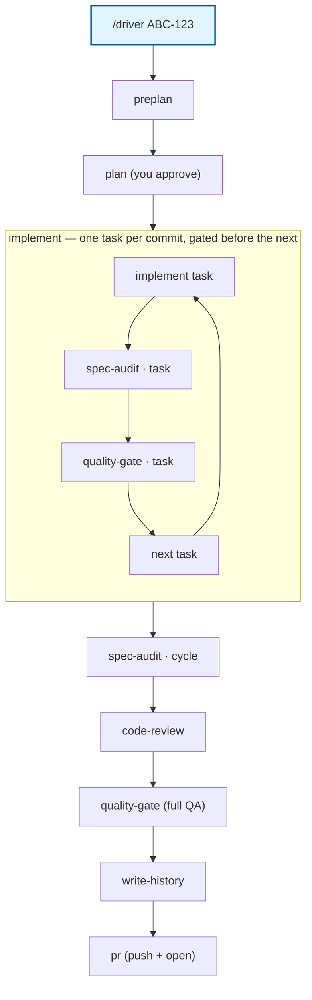

# opencode-agents

[](LICENSE)

A personal library of [OpenCode v2](https://opencode.ai/v2/docs/) agents, commands and skills.

It currently ships one thing: the **driver** — `/driver` runs an entire feature cycle for
you. Each phase runs as its own subagent with a fresh context window, coordinated through a
state file, so no single conversation ever has to hold the whole cycle.

## Contents

- [Quick start](#quick-start)
- [What a run does](#what-a-run-does)
- [Usage](#usage)
- [What lands in your repo](#what-lands-in-your-repo)
- [Requirements & limitations](#requirements--limitations)
- [Hacking on this library](#hacking-on-this-library)

## Quick start

```sh
curl -fsSL https://raw.githubusercontent.com/GoncaloJoaoCorreia/opencode-agents/main/install.sh | sh
```

> [!TIP]
> The final `pr` phase needs an authenticated `gh` CLI (`gh auth login`) to push the branch
> and open the PR for you — see step 4 below.

The installer downloads the latest GitHub release payload (`opencode-agents.tar.gz`),
verifies it against the release's `SHA256SUMS`, and installs `agents/`, `commands/`,
`skills/` into `~/.config/opencode/` (or `$XDG_CONFIG_HOME/opencode`). OpenCode reloads
config automatically — no restart needed.

Working in a local checkout of this repo? Run `./install.sh` there instead — it detects the
checkout and installs straight from source (same copy-based install; nothing is built).
Re-run it after pulling changes.

<details>
<summary><b>Install details</b></summary>

- **Latest release only.** Each install stamps `opencode-agents.version` and writes
  `opencode-agents.manifest` into the config dir; the manifest lets reinstalls remove files
  that were deleted upstream. Installs only ever touch `agents/`, `commands/`, `skills/`
  and those two meta files.
- **Copy-based on purpose** (OpenCode's discovery skips symlinked agent files) — don't
  symlink the directories yourself; see [AGENTS.md](AGENTS.md) for details.
- Releases are cut with the manual **Release** workflow on GitHub (semver tag
  auto-incremented from the latest, validated repo, checksummed assets attached).
- **Public repo, no auth needed** — the one-liner above and the release downloads work
  unauthenticated.

</details>

Before your first run, in the repo you want to work on:

1. Configure the Linear MCP server in that repo's `opencode.jsonc` (the driver reads issues
   through it, read-only):

   ```jsonc
   { "mcp": { "linear-project": { "type": "remote", "url": "https://mcp.linear.app/mcp", "enabled": true } } }
   ```

2. Add `.plan/` to that repo's `.gitignore` (ready-made line in `snippets/gitignore.txt`).
3. Pick a model (and variant) with `/models` — all driver phases inherit your session model.
4. Authenticate the `gh` CLI (`gh auth login`) — the `pr` phase needs it to push the branch
   and open/update the PR on a GitHub remote. Without it (or on a non-GitHub remote) that
   phase skips with a note and you push/open the PR yourself.

Then, from the repo root:

```text
/driver ABC-123        # full cycle for a Linear issue
```

## What a run does



| Phase | Run standalone | What happens |
|---|---|---|
| preplan | `/phases/preplan` | Fetches the Linear issue (or takes a pasted/file spec), picks the QA command, checks the repo setup, writes `.plan/<slug>/state.json` |
| plan | `/phases/plan` | Explores the code and writes `.plan/<slug>/plan.md` + `manifest.json` + `tasks/*.md` — you get asked to approve the plan before anything is built |
| implement | `/phases/implement` | One plan task per commit, in dependency order (`feat`/`fix`/… with module scope); each commit is then gated per task (below) |
| spec-audit | `/phases/spec-audit` | Verifies acceptance criteria against the actual code/commits (runs the plan's verification commands) — once per task right after its commit (`scope=task`), and once over everything at the end (`scope=cycle`; criteria marked `scope: "cycle"` in the manifest are checked there) |
| code-review | `/phases/code-review` | Reviews the cycle's commits, findings prioritized blocker → nit |
| quality-gate | `/phases/quality-gate` | Runs QA and records the verdict — per task the task's scoped `qa.command` from the manifest (skipped when the task declares none; `--qa-scope full` runs the full command per task), and once at cycle end the full `state.qa.command`; failures feed back into repair rounds |
| write-history | `/phases/write-history` | Appends `agent/<module>/history.md` + `decisions.md` and commits them |
| pr | `/phases/pr` | Pushes the branch and opens/updates a PR against the repo's default branch (`gh`), with a short, review-focused description that follows the repo's PR template when one exists |

Per-task gating: right after each task's commit
the driver runs spec-audit (`scope=task`) and quality-gate (`scope=task`) for that task,
each with bounded repair rounds — so every commit on the branch is already audited and gated
before the next task builds on it, and a task counts as done only when its commit passed both
gates. After all tasks, spec-audit and quality-gate run once more at cycle scope (quality-gate
then always runs the full QA command) to catch cross-task integration issues; code-review
always reviews the whole cycle.

Audit, review, and quality-gate never edit code — when they find something, the driver
sends `implement` back with just those findings/failures, in bounded repair rounds
(`--max-rounds`, default 2, per gate). A round's verdict fails only on blocker/major findings;
minor/nit findings are recorded as warnings. If anything still fails after the max rounds,
the driver asks you whether to continue anyway or abort; a phase that errors out prompts
retry/skip/abort. Re-running `/driver` resumes from `.plan/<slug>/state.json` instead of
starting over.

Pre-flight: you must be in a git repo (the session moves to the repo root if needed); a
dirty working tree pauses the run; on `main`/`master`/`develop`/`dev` the driver creates a
`feat/<slug>` branch for you.

## Usage

```text
/driver ABC-123                                  # full cycle, fetches the Linear issue
/driver "add rate limiting to the API"           # raw spec — the driver asks for a slug (e.g. ABC-123)
/driver ABC-123 --phases plan,implement          # only some phases (progress is kept, so this resumes)
/driver ABC-123 --worktree                       # whole cycle inside a new git worktree named ABC-123
/driver ABC-123 --max-rounds 3 --qa "npm test"   # cap repair rounds, pin the QA command
/driver ABC-123 --force                          # re-run the requested phases even if already done
/driver ABC-123 --draft                          # open the PR as a draft
/driver ABC-123 --plan-variant thorough          # use a variant implementation of a phase
/driver ABC-123 --qa-scope full                  # run the full QA command after every task too
/phases/spec-audit ABC-123                       # run a single phase standalone
```

| Flag | Effect |
|---|---|
| `--phases a,b,...` | Run only these phases (default: all) |
| `--worktree` | Run the cycle in a new git worktree named after the slug |
| `--max-rounds N` | Max audit/review/qa repair rounds (default 2) |
| `--qa "cmd"` | QA command override (otherwise auto-detected and confirmed with you) |
| `--qa-scope scoped\|full` | Per-task quality-gate source: the task's scoped `qa.command` (default) or the full QA command; the cycle-scope run always uses the full command |
| `--force` | Re-run the requested phases even if marked done |
| `--draft` | Open the PR as a draft (`pr` phase) |
| `--<phase>-variant <name>` | Swap in a variant implementation of a phase |

## What lands in your repo

- **`.plan/<slug>/`** — scratch, gitignored: `state.json` (cycle state), `spec.md`,
  `plan.md`, `manifest.json`, `tasks/*.md`, `qa.log`, `audit-round-<n>.md` (audit evidence),
  `pr-body.md` (PR description draft), plus per-task gate artifacts `audit-<task>-round-<n>.md` and `qa-<task>-round-<n>.log`.
- **Commits** — one per plan task, conventional format with the module as scope
  (`feat(auth): ...`) plus `Driver-Task:` / `Refs:` trailers. No phase pushes — except the
final `pr` phase, which pushes the branch and opens the PR.
- **`agent/<module>/history.md` and `decisions.md`** — committed by the final phase as a
  `docs(driver): ...` commit. Module = first path segment of the changed files under
  `src/` (else first segment, else `core`).
- **Branch** — `feat/<slug>`, created automatically on protected branches.

## Requirements & limitations

- **Interactive TUI only.** The driver asks questions along the way (slug, plan approval,
  QA command, retries), so headless `opencode run` is not supported.
- **Linear is used read-only** (`get_issue`, `list_comments`, …); the driver never comments
  on or updates issues.
- **The `pr` phase needs the `gh` CLI authenticated** (`gh auth login`) and a GitHub
  remote; on a non-GitHub remote it skips with a note and you push/open the PR yourself.
- **Permissions are permissive by default**: shell commands run without allow/deny
  prompts in all driver agents. Safety comes from the hard `deny` rules (no `git push`
  outside `driver/pr`, no subagent spawning, edit scoped per phase, Linear writes denied).
- All phases inherit your session's model/variant (`/models`).
- Optional: OpenCode's built-in `/goal "<objective>"` can wrap a driver session — the
  driver is idempotent via `state.json`, so repeated goal rounds just resume. (`/goal` is a
  TUI command and isn't available in headless `opencode run`.)

## Hacking on this library

The repo layout, file-format contracts (`.plan/<slug>/state.json`, `manifest.json`, commit
and history formats — single source of truth in `skills/driver-conventions/SKILL.md` with
JSON schemas beside it), extension points, and hard-won gotchas are documented in
[AGENTS.md](AGENTS.md).
