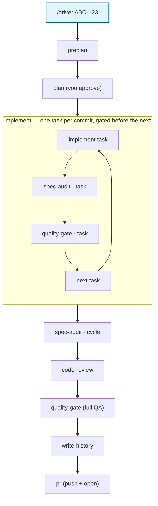
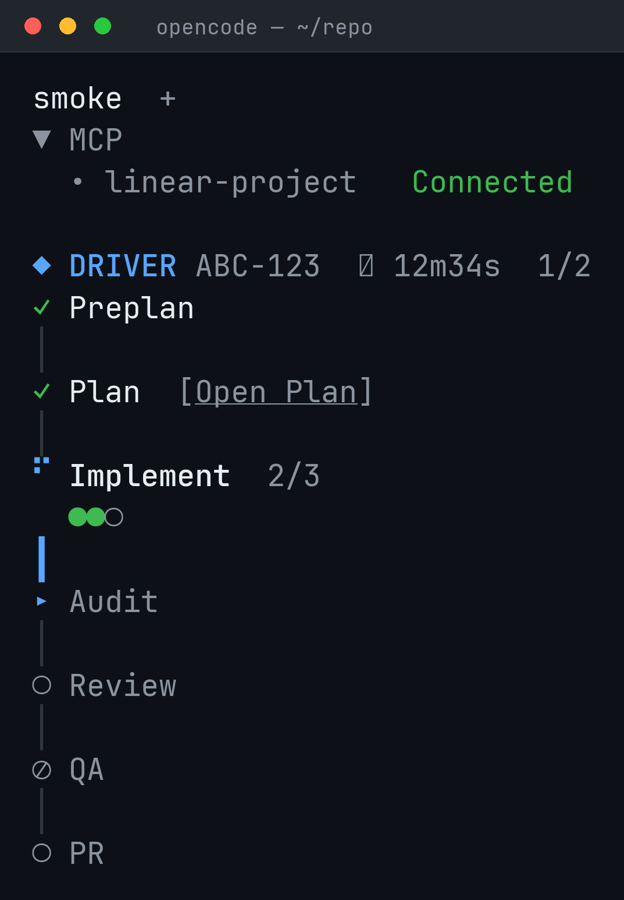

# opencode-agents

[](https://github.com/GoncaloJoaoCorreia/opencode-agents/actions/workflows/test.yml)
[](https://github.com/GoncaloJoaoCorreia/opencode-agents/actions/workflows/release.yml)
[](https://github.com/GoncaloJoaoCorreia/opencode-agents/releases/latest)
[](LICENSE)

A personal library of [OpenCode v2](https://opencode.ai/v2/docs/) agents, commands, skills —
and one TUI plugin.

It ships the **driver** — `/driver` runs an entire feature cycle for
you. Each phase runs as its own subagent with a fresh context window, coordinated through a
state file, so no single conversation ever has to hold the whole cycle — plus
**driver-viz**, a sidebar plugin that shows the live phase flow chart of the current run
(see [Driver sidebar](#driver-sidebar-driver-viz)).

## Contents

- [Quick start](#quick-start)
- [What a run does](#what-a-run-does)
- [Driver sidebar (driver-viz)](#driver-sidebar-driver-viz)
- [Usage](#usage)
- [What lands in your repo](#what-lands-in-your-repo)
- [Requirements & limitations](#requirements--limitations)
- [Hacking on this library](#hacking-on-this-library)

## Quick start

```sh
curl -fsSL https://raw.githubusercontent.com/GoncaloJoaoCorreia/opencode-agents/main/install.sh | sh
```

> [!TIP]
> The final `pr` phase needs an authenticated forge CLI to push the branch and open the
> PR/MR for you — `gh` for GitHub, `glab` for GitLab, `forgejo-cli` for Forgejo — see step 4 below.

The installer downloads the latest GitHub release payload (`opencode-agents.tar.gz`),
verifies it against the release's `SHA256SUMS`, and installs `agents/`, `commands/`,
`skills/`, `agent-scripts/` and `plugins/` into `~/.config/opencode/` (or
`$XDG_CONFIG_HOME/opencode`). OpenCode reloads config automatically — no restart needed.
Pass `--no-plugin` to skip the driver-viz sidebar plugin. The installer requires `python3`
and `git` (hard prerequisite — it fails with a clear message otherwise; see
[Requirements & limitations](#requirements--limitations)).

Working in a local checkout of this repo? Run `./install.sh` there instead — it detects the
checkout and installs straight from source (same copy-based install; nothing is built).
Re-run it after pulling changes.

<details>
<summary><b>Install details</b></summary>

- **Latest release only.** Each install stamps `opencode-agents.version` and writes
  `opencode-agents.manifest` into the config dir; the manifest lets reinstalls remove files
  that were deleted upstream. Installs only ever touch `agents/`, `commands/`, `skills/`,
  `agent-scripts/`, `plugins/` (unless `--no-plugin`) and those two meta files.
- **`.agent/` and `__pycache__/` are never installed.** This repo is itself a driver
  target, so it contains `agents/.agent/`, `skills/.agent/`, … (driver history) — OpenCode
  discovers `agents/**/*.md` recursively, so shipping them would register
  `.agent/history` / `.agent/decisions` as agents. The release tarball and the installer
  both strip them; re-running the installer also removes previously installed copies.
- **Driver helper scripts.** `agent-scripts/` installs to
  `${XDG_CONFIG_HOME:-$HOME/.config}/opencode/agent-scripts/` and holds the six scripts
  the driver agents call from there: `detect-forge.sh` (forge detection for the `pr` phase,
  mirroring `skills/driver-conventions/SKILL.md` §7.1), `detect-modules.py` (module
  detection + file→module mapping for the write-history phase, §4/§8), `driver-state.py`
  (atomic, merge-never-clobber access to `.plan/<slug>/state.json`),
  `save-linear-attachments.py` (eager download of a Linear issue's attachments at
  spec-fetch time — preplan/plan persist `.plan/<slug>/spec.md` with local links, G-23)
  and `qa-command.sh` (the repo-local QA-command cache `git config driver.qa`, §7.3 —
  G-24) and `agent-context-check.py` (context-length check over all
  `.agent/{history,decisions}.md` files — write-history flags over-long files via
  `state.warnings`, §4/§8 — G-31). See `agent-scripts/README.md` in this repo for their
  contracts.
- **Copy-based on purpose** (OpenCode's discovery skips symlinked agent files) — don't
  symlink the directories yourself; see [AGENTS.md](AGENTS.md) for details.
- Releases are cut with the manual **Release** workflow on GitHub (semver tag
  auto-incremented from the latest, validated repo, checksummed assets attached).
- **Public repo, no auth needed** — the one-liner above and the release downloads work
  unauthenticated.

</details>

Before your first run, in the repo you want to work on:

1. Configure the Linear MCP server in that repo's `opencode.jsonc` (the driver reads issues
   through it, read-only):

   ```jsonc
   { "mcp": { "linear-project": { "type": "remote", "url": "https://mcp.linear.app/mcp", "enabled": true } } }
   ```

2. Add `.plan/` to that repo's `.gitignore` (ready-made line in `snippets/gitignore.txt`).
3. Pick a model (and variant) with `/models` — all driver phases inherit your session model.
4. Authenticate the forge CLI for your remote — `gh auth login` (GitHub), `glab auth login`
   (GitLab), or `forgejo-cli auth login` (Forgejo). The `pr` phase needs it to push the
   branch and open/update the PR/MR. On the first run the driver detects the forge from the
   origin remote (probing the CLIs on self-hosted instances) and caches it repo-locally in
   `git config driver.forge`, so later runs skip detection — override anytime with
   `--forge github|gitlab|forgejo`. Without a recognized forge or an authenticated CLI,
   the `pr` phase skips with a note and you push/open the PR/MR yourself.

Then, from the repo root:

```text
/driver ABC-123        # full cycle for a Linear issue
```

## What a run does



| Phase | Run standalone | What happens |
|---|---|---|
| preplan | `/phases/preplan` | Fetches the Linear issue (or takes a pasted/file spec), picks the QA command (cached per repo in `git config driver.qa` after the first confirmation), checks the repo setup, writes `.plan/<slug>/state.json` |
| plan | `/phases/plan` | Explores the code and writes `.plan/<slug>/plan.md` + `manifest.json` + `tasks/*.md` — you get asked to approve the plan before anything is built |
| implement | `/phases/implement` | One plan task per commit, in dependency order (`feat`/`fix`/… with module scope); each commit is then gated per task (below) |
| spec-audit | `/phases/spec-audit` | Verifies acceptance criteria against the actual code/commits (runs the plan's verification commands) — once per task right after its commit (`scope=task`), and once over everything at the end (`scope=cycle`; criteria marked `scope: "cycle"` in the manifest are checked there) |
| code-review | `/phases/code-review` | Reviews the cycle's commits, findings prioritized blocker → nit |
| quality-gate | `/phases/quality-gate` | Runs QA and records the verdict — per task the task's scoped `qa.command` from the manifest (skipped when the task declares none; `--qa-scope full` runs the full command per task), and once at cycle end the full `state.qa.command`; failures feed back into repair rounds |
| write-history | `/phases/write-history` | Appends `<module>/.agent/history.md` + `decisions.md` (repo-root `.agent/` for root-level files) and commits them — only what is worth future reference; nothing is appended when nothing meaningful happened; over-long `.agent` files are flagged as `state.warnings` via `agent-context-check.py` (never fatal) |
| pr | `/phases/pr` | Pushes the branch and opens/updates a PR/MR against the repo's default branch via the forge CLI (`gh` / `glab` / `forgejo-cli`), with a short, review-focused description that follows the repo's PR/MR template when one exists |

Per-task gating: right after each task's commit
the driver runs spec-audit (`scope=task`) and quality-gate (`scope=task`) for that task,
each with bounded repair rounds — so every commit on the branch is already audited and gated
before the next task builds on it, and a task counts as done only when its commit passed both
gates. After all tasks, spec-audit and quality-gate run once more at cycle scope (quality-gate
then always runs the full QA command) to catch cross-task integration issues; code-review
always reviews the whole cycle.

Audit, review, and quality-gate never edit code — when they find something, the driver
sends `implement` back with just those findings/failures, in bounded repair rounds
(`--max-rounds`, default 2, per gate). A round's verdict fails only on blocker/major findings;
minor/nit findings are recorded as warnings. If anything still fails after the max rounds,
the driver asks you whether to continue anyway or abort; a phase that errors out prompts
retry/skip/abort. Re-running `/driver` resumes from `.plan/<slug>/state.json` instead of
starting over.

Pre-flight: you must be in a git repo (the session moves to the repo root if needed); a
dirty working tree pauses the run; on `main`/`master`/`develop`/`dev` the driver creates a
`feat/<slug>` branch for you.

## Driver sidebar (driver-viz)

The installer also drops a TUI-only plugin into `~/.config/opencode/plugins/driver-viz/`
(OpenCode auto-discovers it — no extra config; `--no-plugin` skips it). While a `/driver`
run is active in the repo you're in, the TUI sidebar shows an animated flow chart of the
run, read live from `.plan/<slug>/state.json`:

```text
◆ DRIVER ABC-123  feat/ABC-123  PR #42  1/2  ⏱ 12m34s
✓ Preplan
✓ Plan   [Open Plan]
┃ Implement  3/7    ← connector pulses while the phase above runs
  ●●⠋○○○           ← per-task dots, colored by state, animated while implement runs
▸ Audit
○ Review
○ QA
○ History
○ PR
──────────
Total 1h02m03s · Tokens 128k · +412 -37 · [Open report]
```



`✓` done · `✗` failed · `⊘` skipped · `○` pending · spinner on the running phase (only one
phase shows as running at a time; the spinner is tinted a guaranteed non-white color).
Worktree runs (`--worktree`) show up automatically — the driver moves the session into
the worktree. While a phase runs, the header shows an elapsed-time counter (`⏱`, from the
earliest `phases.*.started_at`); once the plan phase is done, the Plan row offers a
clickable `[Open Plan]` (palette fallback: "Driver: open plan") that opens
`.plan/<slug>/plan.md` with the system default app. When the run completes (all phases
done/skipped), a completion block below the chart shows total time, token usage when the
session exposes it, lines changed (`+A -D` from `git diff --numstat` merge-base..HEAD), and
a clickable `[Open report]` (palette fallback: "Driver: open report") when the driver has
written `.plan/<slug>/report.md`.
The sidebar is session-scoped: it shows only runs whose `state.session_id` (recorded by
the driver at run start) matches the current session's ID, switches immediately to a newly
started run of this session, and `/driver-viz` (palette: "Driver: show next run") cycles
only this session's runs. When no run matches — e.g. all runs have `session_id: null` from
an older driver — the most recently modified run is shown instead. The section hides
itself in repos without a `.plan/` directory. To
disable the animation, register the plugin with options in `cli.json`:
`"plugins": [{ "package": "/abs/path/to/.config/opencode/plugins/driver-viz", "options": { "animate": false } }]`.

## Usage

```text
/driver ABC-123                                  # full cycle, fetches the Linear issue
/driver "add rate limiting to the API"           # raw spec — the driver asks for a slug (e.g. ABC-123)
/driver ABC-123 --phases plan,implement          # only some phases (progress is kept, so this resumes)
/driver ABC-123 --skip quality-gate,write-history # all phases except these (cannot be combined with --phases)
/driver ABC-123 --worktree                       # whole cycle inside a new git worktree named ABC-123
/driver ABC-123 --max-rounds 3 --qa "npm test"   # cap repair rounds, pin the QA command
/driver ABC-123 --force                          # re-run the requested phases even if already done
/driver ABC-123 --draft                          # open the PR/MR as a draft
/driver ABC-123 --forge gitlab                   # force the forge (auto-detected + cached otherwise)
/driver ABC-123 --plan-variant thorough          # use a variant implementation of a phase
/driver ABC-123 --qa-scope full                  # run the full QA command after every task too
/phases/spec-audit ABC-123                       # run a single phase standalone
```

| Flag | Effect |
|---|---|
| `--phases a,b,...` | Run only these phases (default: all) |
| `--skip a,b,...` | Skip these phases — marked `skipped`, never run (incl. their per-task gates). Mutually exclusive with `--phases`; on a fresh run `preplan`/`plan` cannot be skipped |
| `--worktree` | Run the cycle in a new git worktree named after the slug |
| `--max-rounds N` | Max audit/review/qa repair rounds (default 2) |
| `--qa "cmd"` | QA command override (otherwise auto-detected and confirmed with you); the command is persisted per repo in `git config driver.qa` and reused on later runs — override with `git config driver.qa "..."` |
| `--qa-scope scoped\|full` | Per-task quality-gate source: the task's scoped `qa.command` (default) or the full QA command; the cycle-scope run always uses the full command |
| `--force` | Re-run the requested phases even if marked done |
| `--draft` | Open the PR/MR as a draft (`pr` phase) |
| `--forge auto\|github\|gitlab\|forgejo` | Forge used by the `pr` phase (default `auto`: detect from the origin remote, cached in `git config driver.forge`; a concrete value is persisted to that cache) |
| `--<phase>-variant <name>` | Swap in a variant implementation of a phase |

## What lands in your repo

- **`.plan/<slug>/`** — scratch, gitignored: `state.json` (cycle state), `spec.md` (raw
  spec — also written for Linear issues, with downloaded attachments rewritten to local
  links), `attachments/` (eagerly downloaded Linear issue attachments), `plan.md`,
  `manifest.json`, `tasks/*.md`, `qa.log`, `audit-round-<n>.md` (audit evidence),
  `pr-body.md` (PR description draft), plus per-task gate artifacts `audit-<task>-round-<n>.md` and `qa-<task>-round-<n>.log`.
- **Commits** — one per plan task, conventional format with the module as scope
  (`feat(auth): ...`) plus `Driver-Task:` / `Refs:` trailers. No phase pushes — except the
final `pr` phase, which pushes the branch and opens the PR.
- **`<module>/.agent/history.md` and `decisions.md`** — committed by the final phase as a
  `docs(driver): ...` commit; repo-root-level changes land in the repo-root `.agent/`.
  Only entries worth future reference are recorded — nothing is appended when nothing
  meaningful happened.
  Module dirs are detected by the shipped `agent-scripts/detect-modules.py` (build
  system first, in order Gradle → Maven → npm-family → Cargo; fallback: top-level
  dirs, plus `src/*` when a root `src/` exists), and each changed file maps to the
  longest matching module dir.
- **Branch** — `feat/<slug>`, created automatically on protected branches.

## Requirements & limitations

- **Install requires `python3` and `git`.** `install.sh` hard-fails with a clear message
  before installing (or downloading, in release mode) when `python3` cannot execute or
  `git` is missing — the installed `agent-scripts/` (`driver-state.py`, `detect-forge.sh`,
  `detect-modules.py`) need both. A forge CLI (`gh` / `glab` / `forgejo-cli`) is optional: only the `pr` phase
  uses one, and it degrades gracefully (skips with a note) without it.
- **Interactive TUI only.** The driver asks questions along the way (slug, plan approval,
  QA command, retries), so headless `opencode run` is not supported.
- **Linear is used read-only** (`get_issue`, `list_comments`, …); the driver never comments
  on or updates issues.
- **The `pr` phase needs the forge CLI authenticated and the remote recognized** —
  `gh auth login` for GitHub, `glab auth login` for GitLab, `forgejo-cli auth login` for
  Forgejo. The forge is auto-detected from the origin remote and cached in
  `git config driver.forge` (`--forge` overrides); on an unrecognized remote or missing
  CLI the phase skips with a note and you push/open the PR/MR yourself.
- **Permissions are permissive by default**: shell commands run without allow/deny
  prompts in all driver agents. Safety comes from the hard `deny` rules (no `git push`
  outside `driver/pr`, no subagent spawning, edit scoped per phase, Linear writes denied).
- All phases inherit your session's model/variant (`/models`).
- Optional: OpenCode's built-in `/goal "<objective>"` can wrap a driver session — the
  driver is idempotent via `state.json`, so repeated goal rounds just resume. (`/goal` is a
  TUI command and isn't available in headless `opencode run`.)

## Hacking on this library

The repo layout, file-format contracts (`.plan/<slug>/state.json`, `manifest.json`, commit
and history formats — single source of truth in `skills/driver-conventions/SKILL.md` with
JSON schemas beside it), extension points, and hard-won gotchas are documented in
[AGENTS.md](AGENTS.md).
